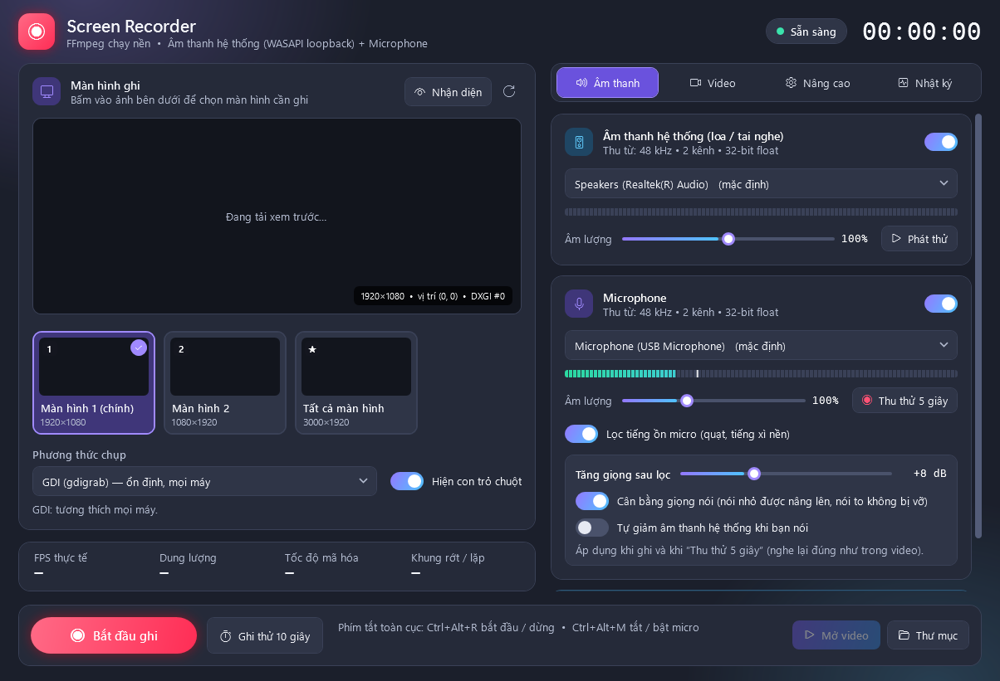

<div align="center">

# 🎬 Screen Recorder

**Ghi lại bài học online — hình ảnh, giọng giảng viên và giọng của bạn — để xem lại bất cứ lúc nào.**

[](#-tải-về-và-chạy)
[](https://github.com/minhngoc8181/ScreenRecorderApp/releases/latest)
[](#)



</div>

## 🎓 Mục đích

Ghi lại các buổi học online để **xem lại khi cần**: nghe lại chỗ chưa hiểu, chép lại phần bị lỡ, ôn bài trước kỳ thi. Thầy cô cũng có thể dùng để lưu bài giảng cho học viên vắng mặt.

> [!NOTE]
> Hãy xin phép giảng viên trước khi ghi và chỉ dùng bản ghi cho việc học.

## ✨ Điểm nổi bật

- 🔊 **Ghi đủ cả hai phía**: tiếng phát ra loa/tai nghe (giảng viên, video) **và** giọng nói từ micro.
- 🎙️ **Giọng rõ, ồn ít**: tự lọc tiếng quạt, tiếng xì nền và tăng giọng của bạn cho cân với tiếng loa.
- 🖥️ **Chọn màn hình bằng hình ảnh**: bấm vào màn hình muốn ghi, kể cả khi dùng nhiều màn hình.
- 🧪 **Thử trước khi ghi**: phát chuông kiểm tra loa, thu thử 5 giây để nghe lại giọng mình.
- 🧳 **Không cần cài đặt**: giải nén là chạy, không cần quyền Admin, không quảng cáo, không thu thập dữ liệu.

## 📥 Tải về và chạy

1. Tải **`ScreenRecorder.zip`** tại trang [**Releases**](https://github.com/minhngoc8181/ScreenRecorderApp/releases/latest).
2. Giải nén ra một thư mục bất kỳ.
3. Nhấp đúp **`ScreenRecorder.exe`**.

> [!TIP]
> Nếu Windows hiện **"Windows protected your PC"**, bấm **More info → Run anyway** (do chương trình chưa được ký số).

Chạy được ngay trên Windows 10/11. Windows 7/8.1 cần cài thêm [.NET Framework 4.8](https://dotnet.microsoft.com/download/dotnet-framework/net48).

## 🚀 Sử dụng

1. **Bấm vào màn hình** muốn ghi.
2. Ở tab **Âm thanh**: bấm **Phát thử** (kiểm tra tiếng loa) và **Thu thử 5 giây** (kiểm tra micro).
3. Bấm **Bắt đầu ghi**. Học xong bấm **Dừng ghi**, rồi **Mở video**.

Video được lưu trong thư mục `videos` cạnh chương trình.

**Phím tắt:** `Ctrl+Alt+R` bắt đầu/dừng ghi · `Ctrl+Alt+M` tắt/bật micro

## 💡 Mẹo nhỏ

| Gặp tình huống | Cách làm |
|---|---|
| Giọng mình nhỏ hơn tiếng loa | Kéo **Tăng giọng sau lọc** lên +10…+14 dB, hoặc giảm **Âm lượng** âm thanh hệ thống xuống 60–80%. |
| Video không có tiếng giảng viên | Chọn đúng loa/tai nghe đang dùng, bấm **Phát thử** thấy thanh âm thanh nhảy là được. |
| Tiếng và hình lệch nhau | Chỉnh **Lệch tiếng so với hình** ở tab **Nâng cao**. |
| Máy yếu, video bị giật | Giảm **Khung hình / giây** hoặc **Độ phân giải xuất** ở tab **Video**. |
| Muốn thử nhanh | Bấm **Ghi thử 10 giây**, video sẽ tự mở để bạn kiểm tra. |

Vẫn chưa được? Hãy gửi mô tả lỗi kèm nội dung tab **Nhật ký** tại mục [Issues](https://github.com/minhngoc8181/ScreenRecorderApp/issues).

## 🤖 Chương trình được làm ra như thế nào?

Screen Recorder được tạo theo phong cách **Vibe Coding**: người làm không ngồi gõ từng dòng mã, mà trò chuyện với trợ lý AI — mô tả mong muốn bằng ngôn ngữ đời thường như *"tiếng tôi nói nhỏ hơn tiếng loa"* hay *"chữ trên tab khó đọc quá"* — rồi chạy thử, góp ý và cùng AI chỉnh sửa cho đến khi vừa ý.

Đó cũng là tinh thần của xu hướng **phần mềm cá nhân tự làm** *(personal software)*: thay vì chờ một ứng dụng "tạm dùng được" cho số đông, mỗi người có thể tự tạo ra công cụ đúng với nhu cầu của mình — nhỏ gọn, riêng tư, không rườm rà — rồi chia sẻ lại cho cộng đồng. Nếu công cụ này giúp ích cho bạn, biết đâu công cụ tiếp theo sẽ do chính bạn làm ra.

<details>
<summary><b>🛠️ Dành cho nhà phát triển</b></summary>

<br>

**Công nghệ:** C# · WPF · .NET Framework 4.8 · [NAudio](https://github.com/naudio/NAudio) (WASAPI loopback + micro) · [FFmpeg](https://ffmpeg.org) (chụp màn hình, xử lý âm thanh, mã hoá H.264 bằng Intel QSV / NVENC / AMF / x264).

**Build** (cần [.NET SDK 6+](https://dotnet.microsoft.com/download)):

```powershell
git clone https://github.com/minhngoc8181/ScreenRecorderApp.git
cd ScreenRecorderApp
# Đặt ffmpeg.exe vào tools\  (tải tại https://www.gyan.dev/ffmpeg/builds/)
dotnet build -c Release                                      # -> bin\Release\net48\
powershell -ExecutionPolicy Bypass -File .\make-dist.ps1     # -> dist\ScreenRecorder.zip
```

**Chẩn đoán** (chạy tại thư mục chương trình, kết quả ghi ra file `.log` cạnh exe):

```bat
ScreenRecorder.exe --selftest 8      :: ghi thử 8 giây không cần giao diện
ScreenRecorder.exe --playtest        :: kiểm tra phát âm thanh ra loa
ScreenRecorder.exe --snapshot ui.png :: chụp giao diện ra ảnh
```

</details>

## 📄 Ghi công

- [FFmpeg](https://ffmpeg.org) — bản build kèm theo của [gyan.dev](https://www.gyan.dev/ffmpeg/builds/), giấy phép GPLv3.
- [NAudio](https://github.com/naudio/NAudio) — MIT License.

---

<sub>🌐 <b>English:</b> a free, portable Windows screen recorder made for capturing online lessons — screen, system audio and microphone — so you can review them anytime. Download <code>ScreenRecorder.zip</code> from <a href="https://github.com/minhngoc8181/ScreenRecorderApp/releases/latest">Releases</a>, unzip and run. Built through vibe coding with an AI assistant.</sub>
